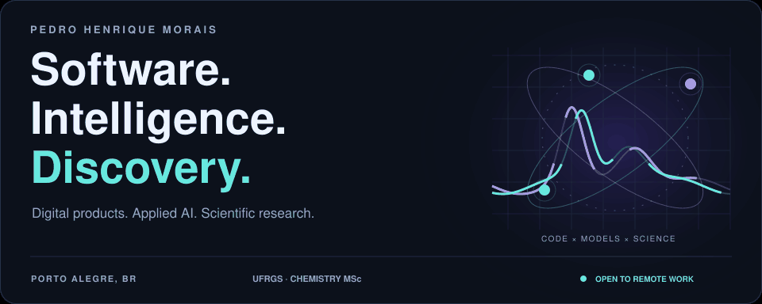
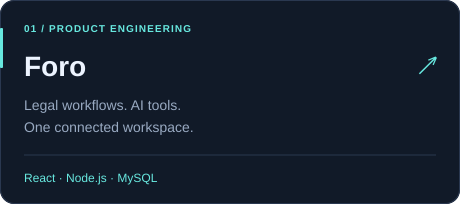
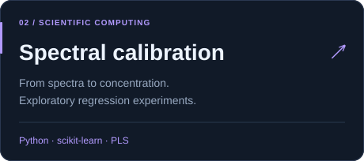
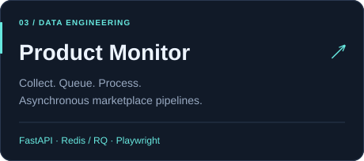
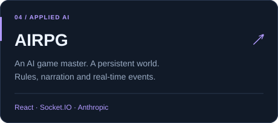
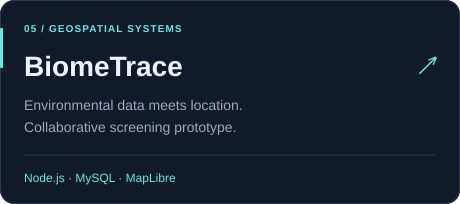
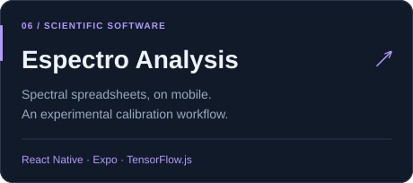
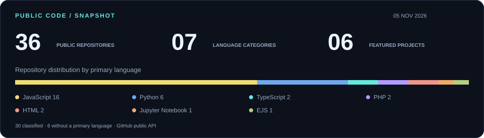

<a href="https://github.com/pedrohsrmorais/pedrohsrmorais/blob/main/README.md">English</a> &nbsp; / &nbsp; <a href="https://github.com/pedrohsrmorais/pedrohsrmorais/blob/main/README.pt-BR.md">Português brasileiro</a>

**Software engineering with a scientific perspective.** I build web applications, AI integrations and data pipelines. At UFRGS, my Chemistry master’s research explores one-class model validation with diffusion-generated synthetic data.

### Selected builds

  
  

  
  

  
  

### The public footprint

Counts include this profile repository and public forks. The distribution uses each repository’s primary language reported by GitHub.

### Tools behind the work

`Python` `JavaScript` `TypeScript` `React` `Node.js` `FastAPI`

`scikit-learn` `TensorFlow.js` `MySQL` `Redis` `Docker` `Git`

### From products to research

- **Analytical Chemistry · UFRGS.** Master’s in progress, focused on machine learning and model validation.
- **Software development · MUVIN.** I worked on the virtual computing museum at UFRGS’s laboratory school.
- **Data and BI.** Experience with operational data, ERP integrations, Power BI and Google Sheets.
- **Software education.** Completed degree in Systems Analysis and Development at UniRitter.

---

**Let’s build something interesting.** Open to international remote work, software contracts and paid research in applied ML and scientific computing. Portuguese and English.

[Personal portfolio source](https://github.com/pedrohsrmorais/Portfolio) · [Public repositories](https://github.com/pedrohsrmorais?tab=repositories)
