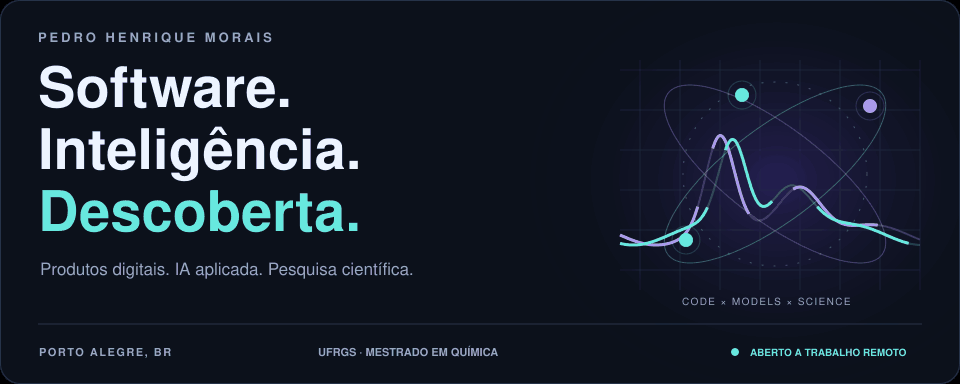
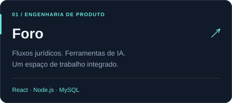
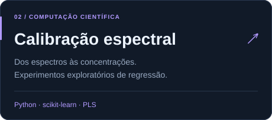
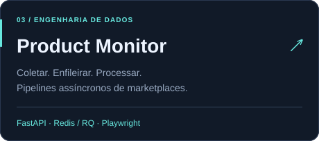
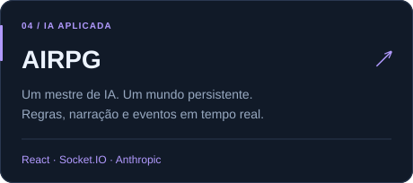
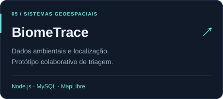
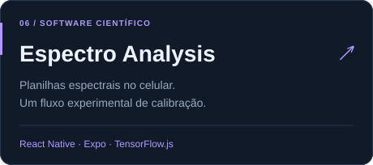
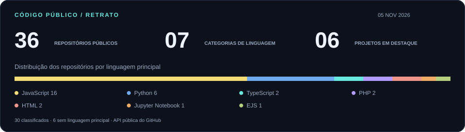

<a href="https://github.com/pedrohsrmorais/pedrohsrmorais/blob/main/README.md">English</a> &nbsp; / &nbsp; <a href="https://github.com/pedrohsrmorais/pedrohsrmorais/blob/main/README.pt-BR.md">Português brasileiro</a>

**Engenharia de software com uma perspectiva científica.** Desenvolvo aplicações web, integrações de IA e pipelines de dados. No mestrado em Química da UFRGS, pesquiso validação de modelos de classe única com dados sintéticos gerados por difusão.

### Projetos selecionados

  
  

  
  

  
  

### Meu GitHub em números

Os números incluem o repositório de perfil e forks públicos. A distribuição representa a linguagem principal de cada repositório, conforme a API do GitHub.

### Tecnologias que conectam meu trabalho

`Python` `JavaScript` `TypeScript` `React` `Node.js` `FastAPI`

`scikit-learn` `TensorFlow.js` `MySQL` `Redis` `Docker` `Git`

### Do produto à pesquisa

- **Química Analítica · UFRGS.** Mestrado em andamento, com foco em aprendizado de máquina e validação de modelos.
- **Desenvolvimento · MUVIN.** Trabalhei no museu virtual de informática do Colégio de Aplicação da UFRGS.
- **Dados e BI.** Experiência com dados operacionais, integrações de ERP, Power BI e Google Sheets.
- **Formação em software.** Graduação concluída em Análise e Desenvolvimento de Sistemas na UniRitter.

---

**Vamos construir algo interessante.** Tenho interesse em trabalho remoto internacional, contratos de software e pesquisa remunerada em ML aplicado e computação científica. Português e inglês.

[Código do portfólio pessoal](https://github.com/pedrohsrmorais/Portfolio) · [Repositórios públicos](https://github.com/pedrohsrmorais?tab=repositories)
